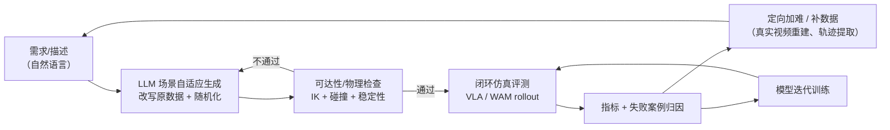

# 数据基建：基于 VLA / WAM 的闭环仿真测试、自适应场景生成与数据生产飞轮

> 整理日期：2026-09-13
> 状态：**两项关键假设已确认**（见 §8）——① 目标引擎为 NVIDIA Isaac Sim（PhysX 5）；② 原笔记「反向动力学」实指 IK（逆运动学）+ 可达性检查。全文已按此定稿。
> 说明：本文是对一段原始构想（要点式笔记）的理解、结构化与技术化拆解，用于对齐目标、拆分模块、明确依赖与验收标准。其余待确认项见 §9。

---

## 0. 一句话概括

**要建的不是一个仿真器，而是一条「场景自动生成 → 仿真闭环评测 → 真人数据/重建数据回灌 → 模型迭代」的数据生产线（Data Flywheel）。**

其中仿真承担两个角色：

1. **评测场**：为 VLA（Vision-Language-Action）与 WAM（World-Action Model）提供可复现、可放大难度的闭环测试环境；
2. **数据源**：通过场景随机化 + 真实场景重建，低成本产出具带真值（ground truth）的训练数据。

核心壁垒不在「能不能跑仿真」，而在 **资产从真实世界自动转化为 sim-ready 场景的自动化程度**，以及 **仿真物理是否足够真实到可以用于评测**。

---

## 1. 术语与背景对齐

### 1.1 VLA 与 WAM 的差别（决定了评测指标的设计）

| 维度 | VLA（Vision-Language-Action） | WAM（World-Action Model） |
| --- | --- | --- |
| 建模目标 | 策略 $\pi(a_t \mid o_{\le t}, l)$ | 联合世界模型 + 动作 $p(o_{t+1:T}, a_{t:T} \mid o_{\le t}, l)$ |
| 输出 | 动作（常为 action chunk） | 未来观测/状态 + 动作（可 rollout） |
| 典型能力 | 语义泛化、语言接地 | 时序预测、长程规划、反事实推理 |
| 典型短板 | 反应式、无显式世界模型、长程弱 | 算力重、训练难、会「幻想」物理 |
| 代表工作 | RT-2、OpenVLA、π0 系列 | 各类 world model + policy 联合训练方案 |
| 对数据的需求 | 需要带动作标注的机器人数据 | 可大量利用**无动作标注的视频** |

**对本项目的影响**：

- 评测 VLA：关注**指令跟随成功率、泛化（新物体/新布局/新语言）**，需要大量带语言标注、可随机化的场景。
- 评测 WAM：除成功率外，还要关注**预测的未来是否物理自洽**（受力曲线、物体是否穿透、是否凭空变形）。
- 因此「受力曲线模拟」「高级物理特性（布料/流体/软体/线缆）」不是锦上添花，而是 **WAM 评测的刚需指标来源**。
- WAM 可用无标注视频 → 使「从视频重建场景 / 从视频提取交互轨迹」这条数据路线的价值放大（ROI 更高）。

### 1.2 闭环仿真的含义

```
策略在仿真中执行 → 采集失败案例 → 定向生成/加难场景 → 重新评测/训练 → 再回到仿真
```

与「一次性跑 benchmark」的区别：**失败案例要能自动转化为下一代场景**（这是"自适应场景生成"要解决的问题）。

### 1.3 关键术语

- **sim-ready 场景**：可直接被物理引擎加载并稳定仿真（有正确单位、碰撞体、质量/惯量、关节、材质、刚体层级、初始位姿无穿模）。
- **随机化（domain randomization）**：布局、位姿、物理参数、纹理、光照、相机位姿等的受控扰动。
- **真值（GT）**：仿真天然可得的分割掩码、深度、位姿、关节状态、接触力、受力曲线、轨迹。

---

## 2. 目标系统总览

### 2.1 三层结构

| 层 | 名称 | 职责 | 产出 |
| --- | --- | --- | --- |
| L1 | 场景与资产层 | 资产生成、重建、语义标注、物理属性标注 | sim-ready 资产库 + 场景描述 |
| L2 | 仿真与真值层 | 物理仿真、传感器仿真、闭环 rollout、真值导出 | 轨迹 / 受力曲线 / 成功率 / 失败归因 |
| L3 | 数据飞轮层 | 难度调度、失败驱动采样、数据配比、训练与回归评测 | 新版模型 + 新一批场景 + 指标报告 |

### 2.2 飞轮流程



---

## 3. 模块拆解

### 3.1 LLM 驱动的场景自适应生成与检查（飞轮入口）

**做什么**

- 输入：自然语言需求 / 描述（如"把冰箱门打开后取出上层左侧的牛奶"、"场景里加 3 个高度相近的干扰物"）。
- LLM 输出：对**场景原数据（scene source data）的结构化改写指令**。
- 改写维度（原始笔记逐条展开）：
  1. **场景布局**：物体数量、类别、相对位置、货架/台面结构、通行空间。
  2. **交互位置**：目标物的初始位姿、朝向、可操作面朝向、机械臂基座与目标相对关系。
  3. **物理属性**：质量、摩擦、阻尼、关节摩擦/限位、门的开启阻力。
  4. **纹理与外观**：材质、颜色、反光、贴图、光照、随机纹理。
- 目标：**生成全新难度（novel difficulty）的任务**，而非简单重复已有场景。

**检查（自校验闭环）**

- 通过 **IK（逆运动学；原笔记写作"反向动力学"，已确认指同一含义）** 求解 + 工作空间判断 + 碰撞检测，自动检查：
  - 目标物体是否**相对机械臂物理可达**；
  - 操作过程是否存在自碰撞/环境碰撞；
  - 抓取位姿是否存在有效解（grasp feasibility）。
- **提供指引（guidance）**：不仅判断可行/不可行，还要输出「如何改才可行」——例如把物体平移/抬高/旋转多少、把障碍物移开。这让 LLM 能形成"生成 → 检查 → 修正"的自动闭环（self-refine），而不是把失败场景丢弃。

**要点**

- 需要给 LLM 一个**场景 DSL / schema**（结构化、可校验、可 diff），而不是让 LLM 直接改文件文本。
- 随机化要**受控且有语义**（"难但合理"），需引入难度标尺（见 §5）。

### 3.2 关节铰链物体（articulated objects）的自动化生成

**做什么**：自动生成带关节的物体——柜门、抽屉、微波炉门、笔记本、剪刀等。

**难点**

- 需要识别**关节类型（revolute / prismatic / 复合）**、**关节轴位置与朝向**、**运动范围（limits）**、**父子刚体划分**。
- 从真人/网络资产、CAD、单图或视频中估计这些参数，本质上是一个**几何 + 语义 + 运动学联合估计**问题。

**技术路径建议**

1. 数据来源：PartNet-Mobility / SAPIEN 类已有资产 + 真实视频/扫描重建资产。
2. 从**交互视频**中利用部件运动轨迹反推关节轴（相对运动 → 螺旋转轴拟合）。
3. 从几何做**部件分割（mobility segmentation）**，再拟合关节参数。
4. 生成后必须做**仿真稳定性回归测试**（开门是否抖动、是否穿模、是否数值爆炸）。

### 3.3 带内部交互物体的自动化生成（冰箱、洗碗机等）

**与 §3.2 的差别**：这类物体是**「外壳 + 内部可动部件 + 内部存放物」的复合体**，是"场景中的场景"。

**难点**

- 需要对各个可动部件做**精确分割与适配（分割 → 关节参数 → 内部空间体积/层次定义）**。
- **简单的碰撞检测无法适用**（原笔记重点）：
  - 内部空间被外壳包围，碰撞检测必然报"穿模"或"不可达"，但它其实是"通过开门可进入"的；
  - 需要**可达性/通行性的语义判断**（门打开后形成的通路），而非纯几何重叠判断。
- 需要建模**内部层级（搁板/层数/抽屉）**，才能支持"取出上层左侧的牛奶"这类指令。

**技术路径建议**

- 建立「**通道图 / 可及性图**」：以关节部件的运动包络（swept volume）为边，判断内外连通性。
- 复合物体用**层次化资产结构**（root → 外壳 → 门/抽屉 → 内部搁板 → 物体）来表达。
- 评测时对"开门 → 伸手 → 抓取 → 取出 → 关门"做**分阶段子任务分解**（便于定位失败环节）。

### 3.4 受力曲线模拟（如打开微波炉门、冰箱门）

**做什么**：模拟并输出**开门/操作过程中的力矩/力-位移曲线（force-displacement profile）**。

**为什么重要**

- 是**仿真真实性的直接判据**：真实门的曲线通常有"初始静摩擦峰值 → 下降 → 保持"的特征；不同铰链（弹簧铰链、阻尼铰链）曲线形态不同。
- 是 **WAM 评测的核心真值**：模型是否"理解"开门需要持续施力。
- 是**仿真到现实（sim-to-real）的关键中介量**：真机上可用力传感器直接对标。

**实现要点**

- 在仿真中导出 **关节力矩 / 末端接触力 / 位移** 的时间序列，形成标准曲线资产。
- 材质与物理参数（关节阻尼、刚度、限位、摩擦）需与实测曲线做**参数辨识/拟合**。
- 建议建立「**曲线库 + 参数化模板**」，让 §3.1 的随机化可以在曲线层面加难（如"阻力更大、更黏"）。

### 3.5 真实感材质与纹理生成

**做什么**：为资产生成正确的、有真实感的 PBR 材质（albedo / roughness / metallic / normal）与纹理。

**价值**：视觉域随机化的前提是"先有真实感，再谈随机化"。视觉不真实会直接污染 VLA 的视觉特征与 WAM 的预测目标。

**技术路径建议**

- 文本/图像驱动的材质生成 + PBR 参数回归（可用生成模型出贴图，再约束物理量范围）。
- 材质库 + 语义标签（"冰箱门-金属拉丝"、"牛奶盒-纸基复合"），便于 LLM 按语义调用。
- 纹理随机化需保证**物理合理性**（别把摩擦/反光随机出不可能的组合）。

### 3.6 高级物理特性支持（布料、流体、软体、线缆）

**背景**：目标引擎为 **NVIDIA Isaac Sim**（PhysX 5 后端）；原文写作"ISSCA Sim"，已确认指同一对象。本节能力对照与工程建议均按此展开。

**能力对照（Isaac Sim / PhysX 5）**

| 特性 | 实现方式 | 常见坑 |
| --- | --- | --- |
| 布料（Cloth） | 可变形表面（deformable surface） | 自碰撞开销大、与刚体耦合易抖动 |
| 软体（Soft body） | 可变形体 / FEM | 参数难标定、GPU 显存与稳定性 |
| 线缆（Cable） | 分段刚体链（jointed rigid）或可变形线性体（deformable linear object） | 版本间 API/实现差异大，需锁定版本 |
| 流体（Fluid） | 粒子法（PBD/粒子流体），**非高保真 CFD** | 精度有限、与刚体双向耦合昂贵 |

**工程建议**

- **锁定引擎版本**，并把高级物理特性纳入 **CI 回归**（每个版本跑固定的稳定性与性能用例）。
- 按"**支撑的交互类型**"分级交付：L1（布料/线缆）→ L2（软体）→ L3（流体耦合），避免一次性全上。
- 与 §3.4 对齐：可变形物体的"受力/形变曲线"同样要能导出。

### 3.7 大规模真实场景重建（from video → sim-ready）

**目标**：把真实视频/影像转化为可仿真的三维场景。这是**数据规模的主要来源**。

**流水线（原笔记的顺序即合理流水线）**


**关键难点**

1. **GS → Mesh**：高斯并非几何，提取水密、可用于碰撞的 mesh 是本环节最大瓶颈；需处理薄壁、透明、反光物体（重建质量差的类别）。
2. **分割**：既要语义分割（是什么），也要**部件级分割**（与 §3.2/§3.3 的关节生成打通）。
3. **补全**：被遮挡区域（如抽屉内部、门后）需要生成合理几何，否则后续交互仿真无法进行。
4. **物理属性推断**：从外观/语义猜质量、摩擦、材质——不可靠，需建立**属性先验库 + 人工抽检**。
5. **碰撞体简化**：视觉 mesh 直接做碰撞体过重，需凸分解/代理体，同时不能破坏交互可操作性。
6. **尺度与坐标系**：真实尺度恢复、重力方向对齐、地面平面对齐，否则仿真物理失真。

**验收要能回答**：重建场景放入仿真后，**能不能被机械臂操作**（不只是"看起来像"）。

### 3.8 视频中交互轨迹提取（真机数据的价值萃取）

**做什么**：从真实交互视频中把"人/机械臂怎么操作物体"变成可用的机器人数据。

**两条产出**

1. **本体轨迹**：
   - 提取机械臂**末端执行器位姿序列（EE pose，6/7 DoF）**；
   - 通过 **IK 反解得到机械臂各关节位姿序列（joint trajectory）**；
   - 关键：IK 需处理**多解、关节限位、奇异位形**，且要与"手眼标定/相机外参"对齐。
2. **物体交互状态**：
   - **物体取放（pick & place）**事件与位姿变化；
   - **夹爪开闭状态**（开/合/夹持中）、开合时刻与物体宽度的对应关系；
   - 扩展：接触时刻、力信号（若有）、物体的关节状态变化（与 §3.2 联动）。

**难点与对策**

| 难点 | 对策 |
| --- | --- |
| 手部/夹爪遮挡，末端位姿不可见 | 多视角、时序平滑、接触感知，或人手 → 机械臂的重定向 |
| 人手与机械臂形态不同 | 重定向（retargeting）+ IK 约束（限位、避障） |
| 相机运动/尺度未知 | 与 §3.7 的重建共享相机与尺度估计 |
| 动作标注噪声 | 一致性检查 + 仿真回放验证（能复现则保留） |

**注意**：原笔记把本环节与 §3.7 并列，但实际二者**强耦合**（共享相机位姿、尺度、分割结果），建议作为同一条"真实视频 → 数据"流水线的两个出口。

---

## 4. 模块依赖关系

| 模块 | 依赖 | 被谁依赖 |
| --- | --- | --- |
| 3.7 真实场景重建 | 视频、分割/补全模型 | 3.8、3.2/3.3（资产来源）、3.5（材质先验） |
| 3.8 轨迹提取 | 3.7（相机/尺度）、IK 求解器 | 数据飞轮（真机数据） |
| 3.2 铰链物体生成 | 3.7（部件分割）、资产库 | 3.4、3.3 |
| 3.3 内部交互物体 | 3.2、可达性图 | 高阶任务评测 |
| 3.5 材质纹理 | 资产库、生成模型 | 3.1（视觉随机化） |
| 3.4 受力曲线 | 3.2/3.3（关节）、3.6（可变形） | WAM 评测、sim-to-real 标定 |
| 3.6 高级物理 | 引擎能力 | 3.4、布料/流体类任务 |
| 3.1 LLM 场景生成 | 以上全部产出（资产 + 属性 + DSL） | 整个飞轮 |

**结论：3.1 是"大脑"，但它的上限完全由底层资产与物理能力（3.2–3.7）决定。** 若资产只覆盖刚体桌面物体，LLM 再聪明也生成不出冰箱或布料任务。建议**先打通一条最小闭环，再横向扩资产类型**。

---

## 5. 验收指标（建议量化）

**场景生成**

- 生成成功率（LLM 一次通过 / 经 N 轮 self-refine 通过）。
- 可达性检查准确率（与人工标注对比）；误判率（把可行判为不可行 / 反之）。
- 难度分布可控性：按难度标尺（如抓取位姿容差、遮挡率、干扰物数量、关节阻力）分层，各层占比可指定。

**重建与资产**

- 重建几何精度：尺度误差、物体位姿误差、mesh 水密率。
- sim-ready 转化率：重建资产中**能稳定仿真的比例**、**能被成功操作的比例**。
- 从视频到 sim-ready 的**端到端耗时与自动化率**（人工介入次数是关键成本指标）。

**物理真实性**

- 受力曲线与真机实测的相似度（如 DTW 距离、峰值力/峰值位置误差）。
- 可变形体仿真稳定性（穿透率、能量守恒漂移、稳定性通过率）。

**飞轮**

- 失败案例 → 新场景的转化率，以及新场景复现同一失败的比率（用于验证评测有效）。
- 单位算力/单位成本产出的有效训练样本数。
- 模型在新一代场景上的成功率变化曲线（飞轮是否真的在转）。

---

## 6. 建议里程碑（分阶段）

| 阶段 | 目标 | 交付物 |
| --- | --- | --- |
| M1 最小闭环 | 打通"LLM 改写场景 → IK 可达性检查 → 仿真 rollout → 成功率报告" | 场景 DSL + 检查器 + 评测脚本 |
| M2 资产自动化 | 铰链/内部交互物体的自动生成 + 稳定仿真回归 | 资产生产流水线 + 资产库 |
| M3 真实感与物理 | 材质纹理生成、受力曲线导出与标定、高级物理分级支持 | 曲线库 + 物理特性 CI |
| M4 真实世界规模化 | 视频 → GS → 分割/补全 → mesh → 物理 → sim-ready | 重建流水线 + 转化率报告 |
| M5 数据飞轮 | 失败驱动采样、难度调度、训练/回归自动化 | 飞轮调度器 + 指标看板 |

（M2–M4 可并行，但都依赖 M1 定义的场景 DSL 与评测协议——**DSL 是全局的收敛点，应最先冻结**。）

---

## 7. 风险与难点

1. **物理真实性的可信度**：仿真里成功的策略在真机失败（sim-to-real gap），尤其是接触密集任务；需要用真实力曲线、材质参数辨识来"锚定"。
2. **GS → 可仿真几何**：目前仍是研究性问题，透明/反光/薄壁物体尤其差；需准备好"降级方案"（代理几何 + 手工修模）。
3. **内部交互物体的自动生成**：零件级分割与关节参数估计的自动化程度可能长期需要人工介入，需评估"半自动流水线"的成本模型。
4. **高级物理的性能**：布料/流体/软体的 GPU 开销与并发场景数直接冲突，影响吞吐（吞吐 = 飞轮速度）。
5. **LLM 生成的可控性**：自由度过高会产出"物理上荒谬"或"不可评测"的场景，需要强 schema 约束 + 检查器兜底。
6. **评测泄漏**：随机化场景若与训练集同分布，指标会虚高；需要明确的**场景版本管理与难度分层**。
7. **成本**：重建与仿真算力、人工抽检、资产维护，都是持续成本；建议早期就定义单位产出的成本指标。

---

## 8. 已确认假设

以下两项原为推断，现已确认，全文按此定稿：

| 假设 | 结论 | 影响章节 |
| --- | --- | --- |
| 目标引擎 | **NVIDIA Isaac Sim**（PhysX 5 后端）；原笔记"ISSCA Sim"指同一对象 | §3.6、§6 |
| "反向动力学" | 实指 **IK（逆运动学）+ 可达性检查**；不涉及力矩可行性/负载约束 | §3.1、§3.8、§2.2 |

## 9. 待确认问题（Open Questions）

1. **资产来源与版权**：以自建扫描/重建为主，还是复用外部资产库（PartNet-Mobility 等）？影响 M2 的起点。
2. **VLA / WAM 的具体模型与观测接口**：输入是单目/多目 RGB、点云、语言指令格式？动作空间是末端位姿还是关节空间？决定仿真侧导出什么真值。
3. **评测基准**：是否有既定 benchmark 要对齐（如某抓取/开门/长程任务集）？是否需要对外可比。
4. **真机数据是否可得**：有力/触觉传感器？决定了 §3.4 的标定能做到什么程度。
5. **吞吐目标**：每天需要生成多少场景、跑多少 rollout？这是架构（本地集群 vs 云）与物理特性取舍的前提。

---

## 10. 原始要点索引（便于溯源）

| 原文要点 | 本文对应章节 |
| --- | --- |
| LLM 驱动的场景自适应生成和检查（改写布局/交互位置/物理属性/纹理） | §3.1 |
| 反向动力学检查目标物体是否物理可达并提供指引 | §3.1 |
| 关节铰链物体的自动化生成 | §3.2 |
| 带内部交互物体的自动化生成（冰箱、洗碗机），简单碰撞检测不适用 | §3.3 |
| 受力曲线模拟（微波炉/冰箱门） | §3.4 |
| 真实的材料与纹理生成 | §3.5 |
| 高级物理特性：布料、流体、软体、线缆 | §3.6 |
| 大规模真实场景重建（3DGS → 分割 → 补全 → mesh → 物理与碰撞 → sim-ready） | §3.7 |
| 视频轨迹提取（末端位姿 → IK 关节位姿）+ 物体取放（夹爪开闭） | §3.8 |
